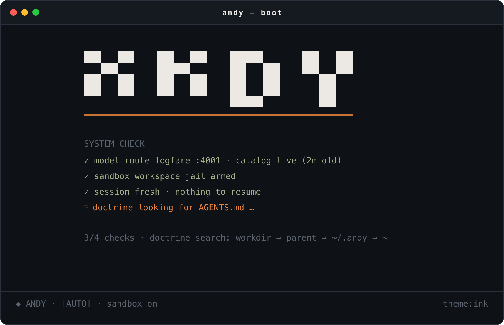
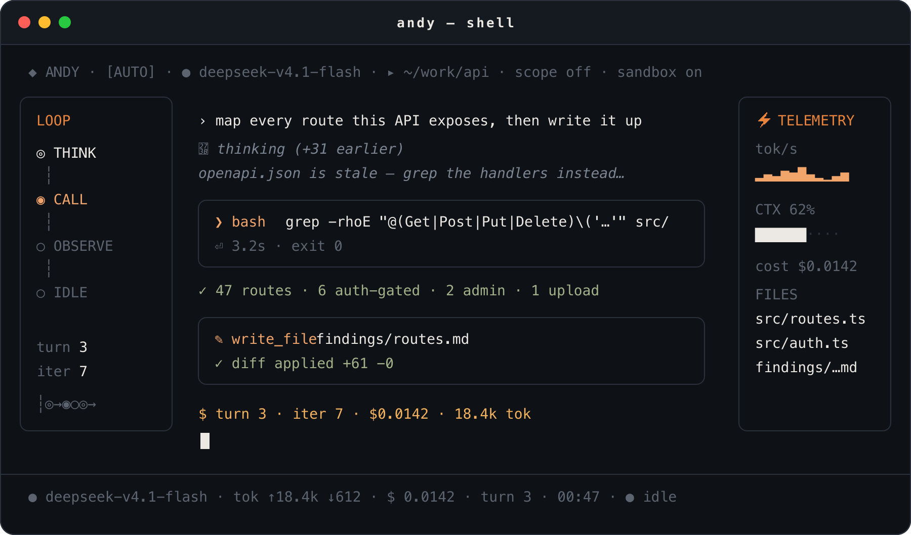
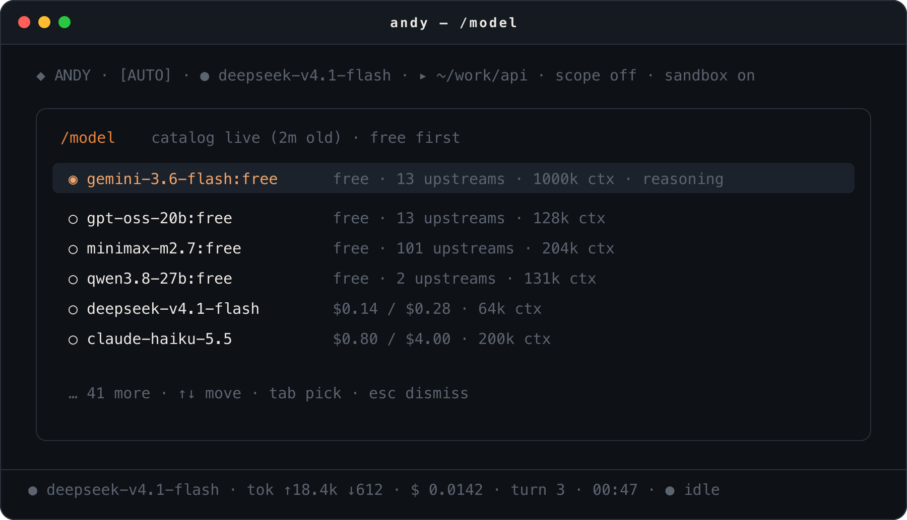
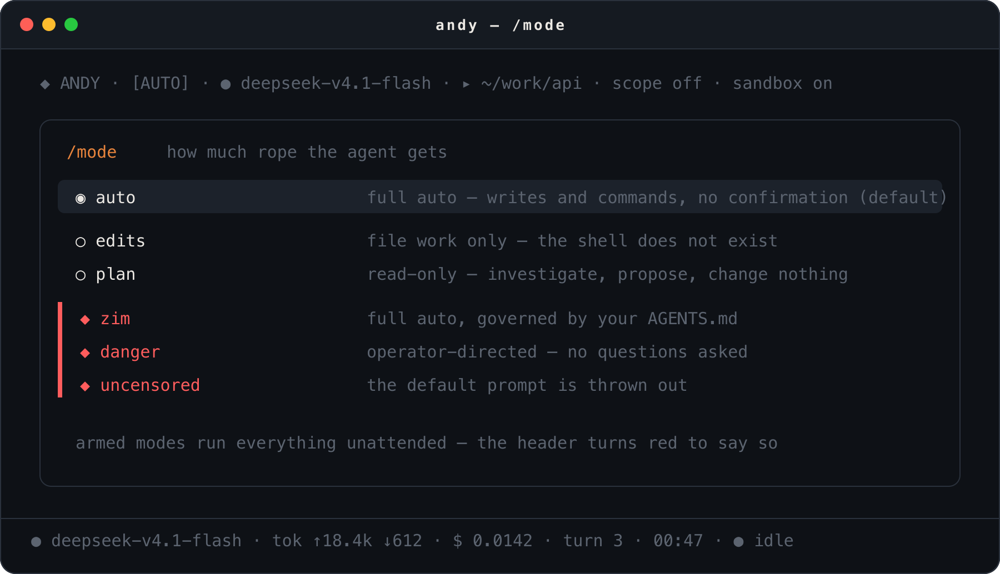

<div align="center">



**An autonomous coding agent that lives in your terminal.**

Hand it a repo and a goal. It reads the code, runs the commands, writes the
files, chases the bug across the tree — and keeps going until the work is
actually finished — while you watch every step.

<sub>by **Mr-Destroyer / ZIM**</sub>


</div>



---

## See it

<div align="center">

### Cold start



*The banner reveals itself, a live system check runs, and then the shell takes over.*

### The shell



*A transcript that streams, a tool card that shows the call while it runs,
and two rails holding the loop and the bill in view. The left rail is the
agent's state — think, call, observe, idle. The right rail is the meter:
throughput, how full the context is, what the session has cost, which files
were touched.*

<table>
<tr>
<td width="50%">



**Swap engines mid-session.**<br>
<sub>Prices in, prices out. No restart, no lost context.</sub>

</td>
<td width="50%">



**Change how much rope it gets.**<br>
<sub>From read-only spectator to full send.</sub>

</td>
</tr>
</table>

</div>

---

## What it does

ANDY is a coding agent you drive from a terminal. Describe the outcome; it
works out the steps, executes them, and shows you everything it did.

- **Talks, then acts.** Ask a question and it answers. Ask for a change and it
  makes the change — reading files, running commands, editing code.
- **Sees your project.** Point it at any directory and that becomes its
  world: it reads, searches and reasons across the whole tree.
- **Runs real commands.** A full shell wired straight into the loop, output
  captured and rendered inline.
- **Edits like a human.** Changes arrive as readable diffs before they land.
- **Shows its work.** Every command, every file touched, every result lands
  in the transcript as it happens — nothing buried in a log.
- **Reads its own markdown.** Models answer in headings, bold, lists, tables
  and fences whether or not anything asked them to. The transcript renders
  that instead of showing the source: `**Asset:**` arrives as a bold
  **Asset**, a dash-and-space becomes a bullet, a pipe grid becomes a real
  wrapping table, and a fenced block arrives syntax-highlighted in the same
  theme tool output uses. It streams that way too, so a half-arrived answer
  reads as prose rather than markup.
- **Keeps score.** Live token counts and a running cost estimate, per turn
  and per session.
- **Answers to a dial.** A mode switch decides whether it merely
  investigates, edits freely, or runs everything unattended.
- **Stays in bounds.** An optional scope file declares what it may touch, and
  a second declares what it must never go near.
- **Remembers the session.** Save it, load it, compact it when the context
  gets heavy.
- **Looks the part.** An ink-and-ember terminal — graphite, bone, one ember accent — animated from boot to prompt. (A classic green phosphor palette ships too, if that is your thing.)

---

## Install

One line:

```bash
curl -fsSL https://raw.githubusercontent.com/Mr-Destroyer/ZimZilla/main/install.sh | bash
```

That clones Andy into `~/.local/share/andy`, installs its dependencies with
`npm install`, builds the CLI bundle there, and drops an `andy` launcher on
your `PATH` (`~/.local/bin`). Nothing to activate, nothing to
`npm install` afterwards — the launcher finds that checkout's own
`node_modules` and runs from any directory:

```bash
andy                           # launch
andy -C ~/some/project         # run against another directory
andy --mode zim                # full auto, follows AGENTS.md
andy --allow allow.yaml        # declare your targets
andy --deny out-of-scope.yaml  # hosts that are never touched
```

If `~/.local/bin` is not on your `PATH`, the installer prints the line to
add. Re-running the same command updates an existing install.

The installer finishes by running `./setup.sh` to configure the route, which
prompts for your credential on the terminal. To configure that yourself
later, or to install somewhere other than the default:

```bash
curl -fsSL <install.sh-url> | ANDY_SKIP_SETUP=1 bash
curl -fsSL <install.sh-url> | ANDY_INSTALL_DIR=~/andy bash
```

`install.sh` honours `ANDY_REPO`, `ANDY_INSTALL_DIR`, `ANDY_BIN_DIR`,
`ANDY_SKIP_DEPS` and `ANDY_SKIP_SETUP`.

### From source

Working on Andy itself, you want the checkout you edit to be the one that
runs. Same launcher, without the clone step:

```bash
git clone <this-repo> ~/andy && cd ~/andy
npm install
./setup.sh                          # verify the route end-to-end
./run.sh                            # launch, no activation
```

`npm install` puts every dependency into the checkout's own `node_modules`,
and `npm run build` emits the `dist/cli.js` bundle the launcher prefers. A
checkout without a build still runs — the launcher falls through to `tsx`
and executes `src/cli.ts` directly — so `./run.sh` works straight after
`npm install`.

`npm install` covers the **harness** only. The LiteLLM proxy is a separate
Python application, installed separately into its own venv
(`~/.andy/venv`, built by `./setup.sh`). If a `litellm` is already on your
`PATH` or at `~/.local/bin/litellm`, `setup.sh` reuses it instead of
building the proxy venv.

`andy` reads its credentials from the environment. The launcher sources the
profile `./setup.sh` wrote before the harness starts, so a normal launch
needs nothing exported by hand.

Out of the box it runs **`deepseek-v4.1-flash`** against Logfare. Switch any
time with `/model`, or override before launch:

```bash
andy -m qwen-3.8-27b               # this run only
ANTHROPIC_MODEL=$MODEL_QWEN andy   # via a profile alias
```

Logfare retires models without notice, so Andy fetches the live list from
Logfare's own status API rather than trusting a baked-in one.
`/logfare-models` shows what is up right now, with uptime, and `/model` is
built from it — the fetched list expires after five minutes, so a long
session cannot keep offering a catalog that has moved on. `/model` says how
old its list is (`catalog live (2m old)`, `catalog expired (1h old)`)
rather than asserting that it is current.

### Updates

Andy updates itself on launch. The launcher runs the checkout in place —
`tsx` on `src/`, or the `dist/` bundle `npm run build` emitted — so the
running code *is* the git checkout, and "updating" means fast-forwarding
that checkout, not reinstalling anything. Every launch checks upstream
first; if there are new commits it says so, pulls them, and restarts on the
new code before the harness comes up.

```
  ⟩ UPDATE
  ◈ updated by 3 commits
    3be2d0c docs(readme): troubleshooting for the pip cache trap
    4a58d45 docs(readme): say which model it starts on
  · restarting on the new code…
```

**Launching Andy pulls and runs code from your `origin`.** That is the
honest description of the feature — it is safe exactly insofar as you trust
the remote you cloned from, the same trust you extend by running
`git pull` by hand. It is on by default because that is what makes it
useful; turn it off with either:

```bash
andy --no-update              # this launch only
export ANDY_NO_UPDATE=1       # every launch in this shell
```

What it will and will not do:

| | |
|---|---|
| **New commits, clean tree** | fast-forwards (`--ff-only`) and restarts on the new code |
| **New commits, edited tracked files** | reports them and **does not pull** — your uncommitted work is never touched, stashed or reset |
| **Untracked files** | ignored — a fast-forward cannot lose them, so they do not block the update |
| **Your branch has diverged** | reports it and **does not pull** — never merges, never rebases |
| **Offline, no remote, not a checkout** | says nothing and boots normally |
| **`package.json` changed** | updates, then refreshes its own `node_modules` and restarts; a hand-managed checkout is told to `npm install` |

If you are developing Andy itself, `ANDY_NO_UPDATE=1` in your shell profile
is the setting you want — otherwise a commit you push from elsewhere will
restart the checkout under you on the next launch.

---

## Usage

```
--model, -m NAME     model to use
--workdir, -C DIR    working directory
--mode NAME          auto | edits | plan | zim | danger | uncensored   (default: auto)
--allow PATH         declared targets — arms the session
--deny PATH          hosts that are never touched
--agents PATH        the doctrine file `zim` mode follows (default: workdir,
                     its parent, ~/.andy, then ~)
--theme {ink,green,amber,cyan,violet,system}
--rain               start with matrix rain on
--no-rain            no rain anywhere
--no-think           never show the model's own reasoning
--max-tokens N       max output tokens per reply
--no-auto-compact    never compact history automatically (/compact still works)
--unsafe             disable the filesystem jail
--panes              run under tmux; ctrl+b h/v open more Andy panes
--resume SESSION     restore a saved session at launch (used by /panes)
--list-models
--version
```

### Panes

`andy --panes` hands the session to tmux on a private socket, so the panes
never collide with your own tmux. `ctrl+b h` splits right and `ctrl+b v`
splits down, each new pane running another Andy that shares a mailbox with
its siblings — so the panes' agents can message each other with
`agent_send`. The status bar carries the reminder.

**The prefix keys are tmux bindings, not Andy bindings** — they only exist
in a session tmux started. In an ordinary session `ctrl+b` is not a prefix
at all, so `ctrl+b h` types an `h` into the prompt. If you are already in a
session and want panes, type `/panes`: it saves the conversation, re-opens
the same session under tmux, and replays the transcript there, so you carry
on where you were. Panes opened afterwards are fresh agents — they can ask
their peers what is going on rather than being handed a copy of your
history.

**If you launch it from inside an existing tmux session, the prefix needs
pressing twice.** The outer server reads `ctrl+b` first and never forwards
it, so a single `ctrl+b h` splits *your* session and the Andy bindings look
dead. `ctrl+b ctrl+b h` forwards one prefix inward and does what you meant;
the status bar switches to saying so when it detects the nesting. Both
forms are harmless standalone, so it is safe to press it twice out of
habit.

A pre-existing server on the private socket would otherwise keep tmux's
stock key table — `tmux -f` is read only when a server *starts* — so
`--panes` sources its config into whatever server it finds before
attaching.

### opencode, behind a rotating IP

`/zim-opencode` opens [opencode](https://opencode.ai) **in this terminal**,
egressing from a different address each time. No account, no API key:
opencode serves a set of free models itself, and they answer with no
credentials on disk at all.

It does three things:

1. **Checks the binary.** Missing, it says exactly
   `opencode not found - install it please !` and prints the install lines
   that work (`curl -fsSL https://opencode.ai/install | bash`,
   `mise use -g opencode`, `brew install opencode`). It never half-runs.
2. **Installs the `opencode-zim` alias** into `~/.local/bin` — a small shim
   that calls back into Andy, so the shell path and the slash command
   cannot drift apart. Delete the file to remove it. It takes no arguments
   of its own; they all go to opencode.
3. **Rotates the exit IP and hands over the terminal.** The pool's cursor
   is persisted, so consecutive runs differ even across restarts.

```console
/zim-opencode                       # open the TUI behind the next proxy
/zim-opencode --refresh             # rebuild the proxy pool first
/zim-opencode --model <id>          # a different free model
/zim-opencode -- --auto --agent build   # everything after `--` goes to opencode
```

**Nothing global is touched.** The proxy is passed to the child process
through its environment, so only opencode egresses through it — your shell,
your other programs and your real address are unaffected. This is *not*
proxychains: no `LD_PRELOAD`, no root, no whole-process-tree hook.

**Why not Tor.** opencode's free tier refuses Tor exit IPs — the same
request that succeeds through an ordinary proxy comes back *"OpenCode's
free tier can only be used from within OpenCode"* through Tor. Tor
publishes its exit list, so refusing it is one line for anyone. That is
also why a commercial VPN works where Tor does not, and it is what makes
ordinary HTTP proxies usable here. (SOCKS is not an option regardless:
opencode's fetch layer rejects `socks5://` outright, which is another
reason the pool is plain HTTP.)

The gate is not a datacenter block, though it looks like one: residential
and datacenter addresses scored *identically* when tested (2/6 each), so
filtering proxies by IP type buys nothing. What it refuses is a specific
set of addresses at a specific moment, which is why the only reliable test
is a real turn.

**The free models need no account — verified properly.** Copy
`~/.local/share/opencode` and `~/.config/opencode` to a temp `HOME`, delete
`auth.json`, and it still answers. (An empty `$HOME` does *not* prove this:
a fresh home has no config or model cache, so it fails for unrelated
reasons. And having an `auth.json` is not evidence against it — the key is
simply unused for these model ids.)

**It is honest about the odds.** What decides whether a launch works is not
whether a proxy carries traffic — it is whether opencode's free tier
accepts that exit IP, and the two are close to independent. Measured: a
pool validated on liveness alone ran **12% usable**, while the same pool
re-validated with real turns ran **79%**. So the command validates in two
stages — a cheap fetch to cut thousands of candidates down, then a real
one-shot opencode turn on the survivors, in parallel. It also tells the
three failures apart, because only two are worth retrying:

| What came back | Verdict |
|---|---|
| the free-tier refusal, a TLS/certificate error, a dead connection | retry the next proxy |
| *"Model is unavailable"* | stop — the id is retired, another proxy will not help |
| nothing worked | say so, with the reason, rather than opening a TUI that will fail |

**Working proxies are not volatile** — re-tested hours later, four of five
still answered — so the pool *remembers*: every proxy that completes a turn
is timestamped and tried first next time. The pool gets cheaper the more it
is used.

Those two goals contradict each other, and the naive version of the first
silently destroys the second. A pool built by turn-validation has *every*
entry proven, so "prefer a proven proxy" returns the same one on every
launch — the first cut of this did exactly that, handing back an identical
address five times out of five. Rotation is therefore tracked separately:
`proven_at` records whether a proxy works, `used_at` records whether you
have already been given it, and each launch takes a proven proxy you have
*not* had yet. Only when they run out does the pool cycle, so a small pool
degrades into reuse rather than into failure. Both markers persist, so a
restart does not reset the rotation.

**A refusal retires a proxy**, because it is newer evidence than whatever
proof put it at the front of the queue. Free proxies die without warning,
and a proxy that answered yesterday and died overnight would otherwise be
tried first on every launch and time out for ~40s before the pool moved on.
If it comes back it is trusted again — the failure is cleared the moment a
real turn succeeds.

While all this runs:

```
  ⠹  ZIM IS MAKING IT UNLIMITED - FINDING THE BEST PROXIES ...
```

No counts, because how many proxies exist says nothing about how many will
be accepted — a pool of 24 measured 12% usable at one point and 79% at
another. The proxy is named once it has been proven, not while it is being
guessed at.

Two caveats worth stating plainly. The free models are opencode's own and
documented as limited-time — they rotate and retire, which is why
`--model <id>` exists and why a retired id is reported instead of retried.
And free proxies see your traffic: opencode's own traffic, but in the clear
as far as the proxy is concerned. Do not send anything through them you
would not send through a stranger's server.

---

## Limits

`/limits` prints all of these for the running session, and says where each
figure came from. Four limits matter, and they are independent — a turn
that stops is almost always one of the last two, not the first.

| Limit | Default | What happens at it |
|---|---|---|
| **Context window** | the model's own, from the live catalog (1M fallback) | History is compacted automatically at 80% — see below |
| **Output ceiling** | 32768 tokens | The reply is cut off; reported as `truncated`, never silently. A cut that carried *nothing* is retried once at double — see below |
| **Rounds before pause** | 40 | The turn **continues** if the last round did real work; otherwise it stops and says so |
| **Hard round limit** | 400 | The turn stops and says so — this is the runaway guard |

### When the ceiling goes to thinking

A reasoning model's thinking is billed against the output ceiling like any
other output, so a model can spend the whole budget before it writes a
word. That is survivable when the thinking reaches you — but through a
proxy that does not forward it, it is not: the reply arrives as a single
`text` block holding an empty string, and the harness is told only that it
was cut off.

Measured 2026-10-16 on Token Juice's `deepseek-v4.1-flash` behind the
LiteLLM proxy, same prompt through both protocol shapes:

```
OpenAI   /v1/chat/completions  finish_reason: length
                               message.content: None
                               message.reasoning_content: "We need answer. Need be careful…"
                               completion_tokens_details.reasoning_tokens: 16   # the whole budget

Anthropic /v1/messages         stop_reason: max_tokens
                               content: [{"type": "text", "text": ""}]
```

The Anthropic shape is what Andy speaks, so a question as ordinary as
*"so where are we ?"* against a loaded session came back as
`reply truncated at 32768 output tokens` with no reply above it — the model
had reasoned its way to the ceiling and the harness could not see any of
it. The warning was also wrong about what had happened: nothing the model
asked for was dropped, so "the requested action may not have run" described
a different failure.

A truncation that carries nothing is now its own shape,
`reasoning_exhausted`, and it is retried once with the ceiling doubled
(capped at 131072). Re-sending costs only a ceiling already known to be too
small, and there is no dropped work to protect — which is exactly why the
mid-`Write` truncation below must *not* be retried, and still is not. If
the doubled ceiling is spent the same way, the turn stops and says so
rather than doubling again. The empty assistant turn is dropped from the
history either way, so the next request does not carry a blank reply.

### Watching the model think

Some models reason before they answer, and some endpoints forward that
reasoning. When one does, Andy shows it: dim and italic, above the answer,
streaming as it arrives — the same thing DeepSeek's own client and OpenCode
display.

```
  ✻ thinking  (+26 earlier)
  the operator asked for the upstream count beside the model, so the
  field is enable_groups, not a health flag — there is no health field
  anywhere in the payload...
```

The live block shows the **last 14 lines** and counts what it elided, so a
model that reasons for a page cannot push its own answer off the screen
while it streams. When the answer starts, the whole reasoning is committed
to the transcript as a `[ ✻ THINKING ]` panel — every line, not the window
— so the elided part is readable in the scrollback rather than lost.
`/think` toggles the whole thing; `--no-think` turns it off at launch.

**Whether you see anything is up to the endpoint, not the model.** Measured
2026-10-16, same prompt, same model family, two endpoints:

| Endpoint | Protocol | Reasoning forwarded? |
|---|---|---|
| OpenRouter | Anthropic-native | **Yes** — `thinking` block, 107 `thinking_delta` events, `thinking_tokens: 490` in usage |
| Token Juice (`:4000`) | LiteLLM → OpenAI adapter | **No** — reasoning exists (`reasoning_content`, 1948 reasoning tokens) but LiteLLM's `/v1/messages` bridge drops it |

So on OpenRouter you watch it think. On Token Juice's
`deepseek-v4.1-flash` you will not, and that is not something the harness
can fix: the thinking is real and is *billed* — it just never crosses the
proxy's Anthropic bridge. This is the same proxy gap that causes the
empty-reply truncation above, seen from the other side. `LiteLLM` 1.100.1
was tested with `merge_reasoning_content_in_choices`, with the `deepseek/`
provider in place of `openai/`, and with every `thinking`-parameter variant
(`budget_tokens` 1024–6000, `reasoning_effort`) — all accepted, none
forwarded. Andy's own code is endpoint-agnostic: where the block arrives it
is shown, and where it does not, nothing changes.

### Why a long turn used to just stop

This was a real bug, reported as *"sometimes in long tasks my models just
go to idle loop."* It was not the context limit and it was not idleness.
The loop ran `for iteration in range(40)`, and on the 41st round it fell
out of the `for` and emitted an ordinary `turn_end` — the same event a
*finished* turn emits. The UI turns that into `IDLE`, so a turn that had
run out of rounds was rendered exactly like one that was done, and nothing
picked the work back up.

Now the two are distinguishable:

- A turn still making progress past the round cap **keeps going**, up to
  the hard limit, printing `N rounds and still progressing — continuing`.
- A turn that stops — because a round achieved nothing, or because it hit
  the hard limit — prints why, and the loop rail reads `CAPPED` rather
  than `IDLE` until the next turn starts.

"Progress" means a tool ran and succeeded. A round of nothing but denials
and errors is the loop spinning, and that is what the cap is for.

### Auto-compact

History is summarised automatically when the **measured** prompt size — the
`input_tokens` the endpoint reported for the previous call — reaches 80% of
the model's window. The trigger is a real measurement, not an estimate, and
it is checked *before* each request rather than after one fails.

The window is per-model: it comes from the active source's live catalog
(UnoRouter's `contextWindow`, OpenRouter's and TokenHarbour's
`context_length`, AntSeed's caps), falling back to `context_window` when
the catalog does not publish one. That matters because the models here
differ by an order of magnitude — a 1M-window free model and a 64k one
cannot share a threshold without the small one overflowing before it trips.

If a request is *still* rejected for being too long, that is recognised as
a context overflow (rather than the generic `bad request` it used to
print), history is compacted, and the round is retried once. `/compact`
still works by hand; `--no-auto-compact` turns the automatic path off
entirely.

---

## Modes

The mode decides how much the agent is allowed to do on its own. Switch at
runtime with `/mode <name>`; the active mode is always visible in the
header.

| Mode | Behaviour |
|---|---|
| `auto` *(default)* | **Full auto** — file writes and shell commands, no confirmation. |
| `edits` | File work is free; the shell is removed entirely. |
| `plan` | Read-only. Investigate, propose, change nothing. |
| `zim` | **Full auto**, governed by your `AGENTS.md`. |
| `danger` | **Full auto**, operator-directed — no questions asked. |
| `uncensored` | **Full auto**, the default prompt is thrown out. The model cannot refuse; it only thinks how to do what you said. |

`zim`, `danger` and `uncensored` are the **armed** modes: everything runs
unattended, and the header turns red to say so. A tool that a mode
disallows does not merely get discouraged — it stops existing for that
session, so `plan` cannot write a file even if you ask it to.

`uncensored` is the one that changes *how the model thinks*, not just which
tools run without asking. Thinking models refuse by reasoning their way to
"I shouldn't"; this mode replaces the whole system prompt so that chain of
thought is not available. `/mode uncensored`, then say the thing.

### zim mode and `AGENTS.md`

`zim` mode hands the wheel to a doctrine file of your choosing. Write the
rules you want followed; that file becomes the agent's whole operating
manual.

It is looked for in this order, first hit wins:

1. `<workdir>/AGENTS.md` — the project's own doctrine
2. `<workdir>/../AGENTS.md` — a checkout's root file, seen from a subdirectory
3. `~/.andy/AGENTS.md` — the installed doctrine (`./setup.sh` puts it there)
4. `~/AGENTS.md` — a hand-kept global file

Step 3 is what makes `zim` mode work from **any** directory: the file is
installed once, so a session opened in an unrelated project still finds
your doctrine instead of silently falling back to the default prompt. A
project that ships its own `AGENTS.md` still wins, because the workdir is
checked first. Override the whole search with `--agents PATH`; switching to
`zim` at runtime with `/mode zim` re-runs the search, so a session that
started elsewhere picks the file up too.

---

## Tools

| Tool | Asks first? | What it's for |
|---|---|---|
| `bash` | in some modes | Run a shell command. |
| `read_file` | no | Read a file, whole or by line range. |
| `write_file` | in some modes | Create or replace a file. |
| `edit_file` | in some modes | Surgical string replacement in a file. |
| `glob` | no | Find files by pattern. |
| `grep` | no | Search file contents by regex. |
| `list_dir` | no | List a directory. |
| `search_web` | no | Search the web. |
| `web_fetch` | no | Pull down a URL. |

When a mode makes a tool ask first, you get a modal showing the exact
command or a colour diff of the change, and three keys:

```
[y] run it     [n] no     [a] always, this session
```

---

## Upstreams

Andy speaks the Anthropic Messages protocol to whatever `ANTHROPIC_BASE_URL`
points at, so it can run against a local LiteLLM proxy, a hosted gateway or
a peer-to-peer marketplace without any code caring which. Seven sources are
wired up:

| Source | Endpoint | Key | How it starts |
|---|---|---|---|
| **Logfare** | `:4001` | discovered | the bundled proxy — the default |
| **Token Juice** | `:4000` | discovered | its own local proxy |
| **TokenHarbour** | `tokenharbor.ai` | yours | hosted — nothing to start |
| **OpenRouter** | `openrouter.ai` | yours | hosted — nothing to start |
| **UnoRouter** | `api.unorouter.com` | yours | hosted — nothing to start |
| **AIHubMix** | `aihubmix.com` | yours | hosted — nothing to start |
| **AntSeed** | `:8377` | **none** | `antseed buyer start` — a local buyer on a P2P network |

Switch with `/zim-logfare`, `/zim-tokenjuice`, `/zim-tokenharbour`,
`/zim-openrouter`, `/zim-unorouter`, `/zim-aihubmix` or `/zim-antseed`;
the choice is remembered, so the next launch comes back to the one that was
working. An endpoint you set deliberately is never overridden by a
remembered choice.

### TokenHarbour

TokenHarbour is remote and needs a key of your own. Set it once:

```
/tokenharbour-api-setup thk_live_yourkeyhere
```

That writes `~/.andy/tokenharbour/source` (mode 600) — the same profile
format as every other source, so it is shell-sourceable too.

If you already keep per-provider profiles for Claude Code, **you do not need
that command**. A profile that is already sourced is honoured:

```sh
source ~/claude-source/haiku-5.5 && andy
```

Andy picks up the base URL, the key and the model from it, and anything
under `~/claude-source` that points at TokenHarbour is found automatically
even when nothing was sourced.

TokenHarbour's catalog is **live** — it changes, and some models are free:

```
/tokenharbour-models      # fetch it now, and list what is free
/model                    # free models first, with prices
/model mimo-v2.5:free     # switch to one
```

`/model` reads the fetched catalog, so free models sort to the top and the
prices shown are the gateway's own rather than a local estimate.

### UnoRouter

UnoRouter fronts a couple of hundred models behind one key and — like
TokenHarbour — speaks the **Anthropic Messages protocol natively**, so
nothing is translated on the way through. It is remote and needs a key of
your own:

```
/unorouter-api-setup sk-yourkeyhere
```

That writes `~/.andy/unorouter/source` (mode 600), the same profile format
as every other source. Then:

```
/zim-unorouter             # switch, and fetch the live free list
/unorouter-models          # the free catalog again, any time
/models unorouter          # the same set, through the generic command
/model gemini-3.6-flash:free
```

**The catalog is public**, so `/models unorouter` works *before* you have a
key — the key is only needed to send a message. That is why the setup
command says so rather than refusing to list anything.

**Free here means free, text-output, and able to call tools** — all three.
The gateway also fronts image generators, embedding models, Whisper
transcription and TTS voices for free, and all of them are genuinely free
and useless to this harness: they cannot answer a Messages turn. Filtering
on the modality as well as the price is what keeps them out of the list.
Measured on 2026-10-16: **230 models in the catalog, 97 free, 46 free and
usable here** — the filter drops 36 for modality and 15 for missing tool
support.

Those counts move as the catalog changes, and they moved between two runs
minutes apart while this was being written (232/99/48, then 230/97/46), so
treat them as a dated snapshot rather than a specification. The
`usable_free_models()` filter is the thing that holds; the numbers are what
it returned on one afternoon.

#### Upstream redundancy — why some free models stall

UnoRouter does not serve a model from one place. Each model has a list of
**upstream channels** behind it, and how many there are decides what a rate
limit means. One channel means a 429 there is the end of the request; a
hundred means the router tries elsewhere and you never see it. That is the
difference between a free model that works and one that appears to hang.

`/models unorouter` shows the count beside every model, coloured by a tier,
and **sorts the list most-redundant first** — so the top of the list is the
safest pick:

```
  ○ minimax-m2.7:free                  101 upstreams · free · reasoning · 204k ctx
  ○ nemotron-3-super-120b-a12b:free    19 upstreams · free · reasoning · 262k ctx
  ◉ gemini-3.6-flash:free              13 upstreams · free · reasoning · 1000k ctx
  ○ gpt-oss-20b:free                   13 upstreams · free · reasoning · 128k ctx
  ...
  ○ glm-4.5-flash:free                 1 upstream · free · 131k ctx
```

The share that matters holds even though the counts do not. Measured on
2026-10-16 across three consecutive reads, the number of usable free models
moved 47 → 45 → 42 while the **single-channel share stayed at 38–42%** — so
roughly **two in five of the free models on offer have exactly one
upstream**, and those are the ones that stall. They were previously
indistinguishable from the rest of the list. As with the counts above,
treat any absolute figure here as a dated snapshot: the ratio is the
finding, the totals are one afternoon's reading.

Two things this is **not**, both worth stating plainly:

- **It is not a health signal.** UnoRouter's public catalog publishes a
  channel *list* and no per-channel status — checked field by field, there
  is no such field on the API. A model with 20 channels could have all 20
  degraded. What is counted is how many places the router *could* go, not
  how many are answering.
- **The tier boundaries are Andy's, not UnoRouter's.** The count is
  measured; where "good" begins (`UPSTREAM_THIN = 5`) is our judgement
  about the point at which one channel failing stops mattering. The number
  is printed next to the colour so the colour can never be mistaken for
  something the gateway said.

A model whose catalog entry carries no channel list reads as `unknown` and
is left uncoloured — absence of the field is not evidence of a single
channel.

A note on prices: UnoRouter publishes *credit ratios*, not dollars per
million tokens, so this integration does not invent a rate from them. Free
models read `free` — which is exact — and a paid model falls through to
Andy's own estimate table, labelled as an estimate.

**`/zim-unorouter` never lands you on a paid model.** With no preference
saved it names a free model by default, so a fresh switch costs nothing.
The default is a *measured* shortlist, ordered by whether the model
actually returns a `tool_use` block rather than by the catalog's
`supportsTools` flag. That flag is a good filter and not a guarantee:
`nemotron-3-super-120b-a12b:free` advertises tool support and a 262k
context, and answered a real tool-using request with a completed turn in
prose. It was ranked highly here on the strength of one early sample and
removed once re-measured — which is the whole reason the shortlist is short
and each entry is one that was actually seen calling a tool.

The measurement has to be done with the requests **spaced**. Hammering one
model back to back measures the free tier's rate limiter, not the model.

Even spaced, though, **a small sample cannot rank these models.** Two
sweeps of the same five, three attempts each, disagreed on every one of
them:

| model | first sweep | confirmation |
|---|---|---|
| `gemini-3.6-flash:free` | 3/3 | 2/3 |
| `qwen3.8-27b:free` | 3/3 | 2/3 |
| `glm-5.3-flash:free` | 3/3 | 1/3 |
| `deepseek-v4.1-flash:free` | 1/3 | 2/3 |
| `gpt-oss-20b:free` | 1/3 | 2/3 |

The run-to-run variance is larger than the difference between the models,
so the honest reading is not "gemini is best" but **all five can call a
tool and none does so dependably** — a property of the free tier rather
than of any one model. The shortlist therefore records what was *verified*
(each name returned a real `tool_use` at least once) and breaks the tie on
**upstream redundancy** first, **context** second. The default is
`gemini-3.6-flash:free` with `gpt-oss-20b:free` behind it — both with 13
channels, so the context tiebreak decides and `gemini`'s 1M window wins.
`qwen3.8-27b:free` and `glm-5.3-flash:free` sit at **one or two** channels
and rank below them.

The reordering came from this same measurement, and it corrected a mistake
worth recording: a single read put `gpt-oss-20b:free` at 14 channels
against `gemini`'s 12, which looked like grounds to promote it. Five
consecutive reads then showed both at 13 every time — the gap was drift,
not signal. Promoting on it would have been reading noise into a ±2 wobble,
so the two are treated as tied. What the counts *do* settle is that two of
the five shortlisted names have a single channel, so the model this harness
chose on the operator's behalf was, a third of the time, one of the fragile
ones. A default that quietly picks a model which rate limits is the same
complaint as a list that hides which models rate limit.

Entries do disappear: `glm-5.3-flash:free` was gone from the catalog within
the hour it was measured, and `deepseek-v4.1-flash:free` is gone now. The
list falls through to the next name and then to the catalog's own order, so
a vanished entry costs one lookup rather than a broken switch.

### AIHubMix

AIHubMix is a hosted gateway fronting ~857 models behind one key, and it
serves `/v1/messages` **natively** — real Anthropic-shaped replies with
`thinking` / `text` / `tool_use` blocks and a proper SSE stream, no
translation layer. Set it up:

```
/aihubmix-api-setup sk-yourkeyhere
/zim-aihubmix               # switch
/aihubmix-models            # the live catalog, any time
```

**The catalog is public** — `GET /api/v1/models` answers with no key at
all — so `/aihubmix-models` works before you have set anything, the same
deal as UnoRouter.

**The free tier actually runs.** `coding-glm-5-free` and
`qwen3.8-flash-free` both answered a real request on a key with no credit
balance, while the paid ones returned `403 "Your account balance is
insufficient"`. So the free models are usable on their own, and
`/zim-aihubmix` names a free one by default — it never lands you on a paid
model.

Two traps, measured rather than guessed:

- **Do not trust the `tool_call` field to mean "no tools".**
  `qwen3.8-flash-free` carries `tool_call: null` and still returns a
  `tool_use` block when handed a tool. Filtering the free list on that
  field — the obvious thing — would hide working models. It is recorded
  for display and never used to exclude.
- **The `-free` / `:free` suffix is not the free signal.** Six
  `meta-llama/…:free` and `mistralai/…:free` entries carry a non-zero 0.02
  price; they are *not* free. Meanwhile 50 entries are priced 0/0. The
  price is the truth and the suffix is a hint.

### AntSeed

AntSeed is not a gateway. It is a peer-to-peer marketplace: independent
sellers advertise models, and a **buyer** process you run locally routes
your requests to them. Install it, then start the buyer once:

```sh
antseed buyer start          # serves http://localhost:8377
```

Then `/zim-antseed` — **there is no key to set.** The buyer authenticates
nothing; a request with no `Authorization` header at all comes back 200.
Setup commands have nothing to store here, and Andy says so rather than
pretending.

The catalog is public and changes constantly, so look before you switch:

```
/antseed-models            # the free models, each with the peer to pin
/models antseed            # the same set, through the generic command
```

**Free means a free seller, not a free model.** A model is free when at
least one peer serving it charges 0 in and 0 out. A model that is free in
but paid out is a paid model, and is listed as one. Expect the free set to
be a handful out of a few hundred — the exact count moves as sellers come
and go, which is why `/antseed-models` fetches rather than quoting a
number.

**Why the list looks like `4668854b…@glm-4.5-flash`.** That `peer@model`
form is AntSeed's own pinning syntax, and it is the whole point of this
integration. The router ranks peers by price *and* trust, with
`minTrustScore` defaulting to 60 while free peers cluster below it — so
asking for a free model by its bare name gets you

```
502 model_not_found: No policy-allowed peer currently serves model "glm-4.5-flash".
```

even though the peer is online. The pin bypasses that ranking, and it needs
no client change at all: no header, no extra option, just the model id.

A pin bypasses the *ranking*, not the seller. A seller is a stranger's
machine, and it can be busy or refuse — on one measurement of the free
pins, most answered with a real reply while others returned `429` or
`502 "pinned peer could not complete"`. So Andy lists every free pin rather
than promising one, and `/model` orders them by protocol support and trust.
If one 429s, try the next.

**`/zim-antseed` never lands you on a paid model.** With no preference
saved it names a free pin by default, so a fresh switch costs nothing. That
default is a *measured* shortlist — `nemotron-120b-free`,
`nemotron-3-ultra-free`, `glm-4.5-flash`, `qwen2.5-coder-7b` — and it is
ordered by whether the seller actually answers, not by reputation, because
reputation does not predict it. Of the nine free pins measured on
2026-10-15, the **highest**-trust free seller returned `502` twice and the
**lowest**-trust one returned `200` twice. Choosing a pin with
`/model <peerId>@<model>` remembers it, so the next launch returns to the
same seller.

Two smaller things worth knowing:

- Every seller on the network advertises the OpenAI protocol and none
  advertises Anthropic — the buyer translates for you. It works, but it is
  a translation, not a native protocol, so the occasional
  `400 unsupported_protocol` from a particular seller is a property of that
  seller rather than a bug here.
- The reasoning models spend the token budget before emitting any text. A
  200 with `content: []` and `stop_reason: max_tokens` at `--max-tokens 32`
  becomes real prose at 256. Andy's default is well clear of this.

### LDXHub — document jobs, not chat

LDXHub is wired in as a **sidecar**, not a source: its six document-processing
services live at `gw.ldxhub.io` and both `/v1/messages` and
`/v1/chat/completions` 404 there, so it deliberately never appears in the
upstream switch. Its catalogs are public, and a missing key is a first-class
case (the `Authorization` header is omitted entirely rather than sent empty).

```
/ldxhub-api-setup sk-yourkeyhere   # store the key (mode 600, like every source)
/ldxhub-models                     # models/engines per service — pick defaults
```

---

## Scope

Two files, one job each. Both are picked up automatically from the working
directory, or pointed at with `--allow` / `--deny`.

**`allow.yaml` — your declared targets.** Its presence **arms the session**:
gated tools stop asking. It is a declaration of what you are authorised to
work on, not a fence around you — it restricts nothing and blocks nothing.

```yaml
domain:            # a domain also covers its subdomains
  - example.com
ip:
  - 203.0.113.10
cidr:
  - 198.51.100.0/24
```

**`out-of-scope.yaml` — never touch.** This one is enforced. A command that
reaches for one of these hosts is stopped before it runs, and fetching one
is refused outright.

```
⛔ BLOCKED — SCOPE GUARD — HARD BLOCK
   out-of-scope.example.com — denied — listed domain
```

```yaml
domain:
  - out-of-scope.example.com
```

Deny always beats allow. Loading only `out-of-scope.yaml` arms nothing — it
only subtracts.

### What this is and is not

Worth being straight about, because the difference matters:

- The allow-list is an **arming mechanism, not a safety control**. With it
  loaded, the only thing between the agent and an arbitrary host is
  `out-of-scope.yaml`.
- The deny-list is a **check on what it's about to do, not a sandbox**. It
  reads the command as written. A target assembled at runtime, or reached
  through an unlisted redirect, is not something it can see. It catches the
  obvious mistake; it does not stop a determined command.

Use it as a seatbelt, not as a cage.

### Upgrading from `scope.yaml`

`scope.yaml` is no longer read. It was one file doing three jobs at once,
and its meaning cannot be carried across safely — reading it as a
deny-list would block exactly the hosts it declared. A stale `scope.yaml`
is reported loudly at startup and then ignored. Rename it to `allow.yaml`
or `out-of-scope.yaml`.

---

## Slash commands

| Command | Effect |
|---|---|
| `/help` | command reference |
| `/mode [name]` | show or switch mode |
| `/model [name]` | show or switch the model |
| `/cost` | session token + cost breakdown |
| `/scope` | scope status and entries |
| `/theme ink\|green\|amber\|cyan\|violet\|system` | switch palette — `system` adopts the terminal's own colours |
| `/rain` | toggle the matrix rain |
| `/think` | show the model's own reasoning — where the endpoint forwards it |
| `/panes` | re-open this session under tmux — `ctrl+b h`/`v` split |
| `/zim-opencode [--model id] [--refresh] [-- args]` | open **opencode** in this terminal behind a fresh rotating IP — free models, no account, nothing global |
| `/save [name]` | write the session to disk |
| `/load [name]` | restore a session |
| `/compact` | summarise history to free context |
| `/limits` | context window, round caps and timeouts — and where each figure comes from |
| `/team <task>` | fan the task out across parallel agents |
| `/osint <kind> <target>` | open-source recon on a target |
| `/osint-tree [kind\|path]` | re-show a finished recon as a result tree |
| `/phish <host>` | clone a login page, serve it, harvest creds into zim-pane |
| `/zim-logfare` | switch upstream to Logfare (`:4001`) |
| `/logfare-models` | the live Logfare list, with uptime — the default route's own status API |
| `/zim-tokenjuice` | switch upstream to Token Juice (`:4000`) |
| `/zim-tokenharbour` | switch upstream to TokenHarbour (hosted) |
| `/tokenharbour-api-setup <key>` | store your TokenHarbour API key |
| `/tokenharbour-models` | fetch the live catalog; show what is free |
| `/zim-openrouter` | switch upstream to OpenRouter (hosted) |
| `/openrouter-api-setup <key>` | store your OpenRouter API key |
| `/zim-unorouter` | switch upstream to UnoRouter — hosted, free models, native Messages |
| `/unorouter-api-setup <key>` | store your UnoRouter API key |
| `/unorouter-models` | the live free catalog — free, text-output and tools-capable, most upstream channels first |
| `/zim-aihubmix` | switch upstream to AIHubMix — hosted, native Messages, free tier |
| `/aihubmix-api-setup <key>` | store your AIHubMix API key |
| `/aihubmix-models` | the live catalog — free first, price is the truth |
| `/zim-antseed` | switch upstream to AntSeed — the local buyer, free peers, no key |
| `/antseed-models` | list AntSeed's free models, each with the peer to pin |
| `/ldxhub-api-setup <key>` | store your LDXHub API key (document jobs) |
| `/ldxhub-models` | LDXHub models/engines — pick the default per service |
| `/models [source]` | free models of an upstream — `logfare`, `tokenjuice`, `tokenharbour`, `openrouter`, `unorouter`, `aihubmix`, `antseed` |
| `/zim-source` | show every upstream and its status |
| `/scope-validator` | paste a programme overview → scope files + ranked targets |
| `/bug-hunt [--fresh] [--wave N] <target>` | recon (reused if already done), then **one** wave of 10 agents |
| `/ad [--fresh] [--wave N] [--lockout N] [--arm] <domain> --ack <domain>` | Active Directory campaign — gated and interlocked |
| `/ad tools` | reprint the AD tool probe |
| `/crack <file\|dir> [--mode N] [--max-time S] [--deep]` | crack hashes offline — CPU only, budgeted |
| `/stop-hunt` | end a running hunt |
| `/summary-hunt` | the hunt report — what each wave did |
| `/report-bug-hunt` | evidence-only report — every wave, raw evidence, no remediation |
| `/findings` | the finding tracker — every bug found, worst first |
| `/clear` | wipe transcript and history |
| `/exit` | leave |

**Prompt affordances.** Type `/` and the command menu opens as you type;
type `@` and a file picker opens, rooted at your working directory.
Accepting a file mention attaches its contents to your message, so the
agent can act on it immediately. `↑`/`↓` to move, `Tab` to accept, `Esc`
to dismiss.

**Keys.** `Ctrl+K` command palette · `Ctrl+C` interrupts the current turn ·
`Ctrl+D` exits · `Ctrl+L` clears.

**Mouse.** Drag across the transcript (or either rail) to select, and the
selection is copied to your clipboard the moment you release — so you can
paste a tool result straight into a report. The rails are resizable: grab
the inner edge of the loop rail or the telemetry rail and drag it to trade
width between the rail and the transcript. The transcript re-wraps to
whatever width the pane ends up at, so nothing goes ragged when you resize
the terminal and come back. Hold your terminal's usual modifier (usually
`Shift` or `Alt`) if you want a native selection instead.

The palette is the fastest way to reach anything: hit `Ctrl+K` and type a
few letters. It searches every slash command, every mode, every model on
your upstream, and every file in the working directory — so `/mode zim` is
`mkz`, and a file you half-remember is three characters away.

---

## OSINT

`/osint` runs open-source intelligence on a target you declare. It is a
router: pick a *kind*, and the command validates the target, opens a case
directory, and hands that kind's playbook to the main agent as one turn. The
recon then runs exactly like any other turn — same tools, same scope guard,
same transcript, same `Ctrl+C` — so you can watch it and interrupt it.

```
/osint email target@example.com

  ◈ CASE      email · target@example.com
  ◈ EVIDENCE  ~/.andy/osint/email-target-example.com-20261005-143210/
  ◈ NOTICE    authorised use only — your own footprint, a consented audit, or a declared engagement
```

Run `/osint` with no arguments for the menu:

| Kind | Target | Status |
|---|---|---|
| `email` | email address | **built** |
| `phone` | phone number | not built yet |
| `facebook` | profile URL, id or username | **built** |
| `tiktok` | username or profile URL | **built** |
| `instagram` | username or profile URL | **built** |
| `discord` | username or user id | **built** |
| `github` | username | **built** |

The one unbuilt kind is listed so the surface is discoverable; selecting it
says so and stops rather than pretending to work.

**`email`** works the address through seven phases: validation and provider
fingerprinting (MX/TXT, whois), Gravatar, breach exposure, account discovery
(`holehe`, `sherlock`), identity correlation, domain intelligence for custom
domains, and paste/code leak search. Every finding is tagged **CONFIRMED**,
**PROBABLE** or **UNVERIFIED**, and the run ends by writing `report.md` into
the case directory.

**`github`** runs the same idea in reverse — it starts from a handle and
hunts for the person behind it. Phase 2 is the point of the run: a GitHub
account almost always leaks its owner's email address, and that is the pivot
from a username to an identity. It mines `git` history (every name and
address that ever committed), `.patch` headers (`From: Name <email>`), GPG
uids and SSH keys, and the files developers routinely commit addresses into
— `package.json`, `pyproject.toml`, and `.mailmap`, whose whole purpose is
mapping contributors to addresses. From there it profiles the account,
inventories the repos, maps the social graph (orgs, collaborators) and
reconstructs a timeline. Committed secrets are reported by location and
described, **never reproduced**. A pasted profile URL is accepted and
unwrapped, so `https://github.com/torvalds` and `torvalds` are the same run.

```bash
/osint github torvalds
/osint github https://github.com/torvalds    # same thing
```

**`discord`** is the most closed of the kinds, and the playbook is written
around that rather than pretending otherwise — an agent that spends its
phases hammering a `401` produces a report that says nothing.
Unauthenticated, Discord gives you almost nothing about a user:
`api/v10/users/<id>` is `401`, and `discord.com/users/<id>` is a JavaScript
shell whose `og:title` is the generic Discord marketing string. So the run
does the two things that *do* work, in this order:

- **The id-derived facts, which are free and exact.** A snowflake is not
  opaque: `(id >> 22) + 1420070400000` is the Unix millisecond the account
  was created, and `(id >> 22) % 6` picks the default avatar. Both are
  computed locally — no request, no rate limit — and the creation date
  anchors the whole run. An account from 2016 and one from last month are
  different findings.
- **The cross-platform pivot, which is the payload.** A Discord handle is
  very often the same string its owner uses on platforms that *do* answer,
  so the run pivots through `sherlock`/`maigret` and the same
  Gravatar/breach/`holehe` logic `/osint email` already uses. The
  account-creation date is what disambiguates "the same person" from "a
  common word".

Two limits are stated rather than discovered: the only unauthenticated
username probe (`username-attempt-unauthed`, which answers
taken/available) rate-limits almost immediately and its `retry_after`
**escalates** — 161s, then 2028s within a handful of requests — so it is a
one-shot check, never a loop; and the guild `widget.json` endpoint — the one
rich native source, and only for guilds that have widgets switched on — is
**anonymised**: member ids come back as `"0","1","2"` and usernames
truncated, so members cannot be attributed from it. What it is good for is
the *guild*: name, size, channels and an invite code, which resolve through
`invites/<code>?with_counts=true`. The report ends with a `LIMITS` section
saying exactly what a token would have added, because for this kind that is
one of the most useful parts of it. If the operator supplies their own
`DISCORD_TOKEN` the picture changes completely — a scraped or self-bot token
is never used.

```bash
/osint discord someuser
/osint discord 80351110224678912
/osint discord https://discord.com/users/80351110224678912   # same as above
```

**`facebook`** is the kind where the obvious approach is the wrong one, so
the playbook opens by naming the wall. Unauthenticated,
`facebook.com/<user>` returns **HTTP 400** — a 1542-byte XHTML-MP error
shell with no `og:` tags and no JSON to parse — and the usual workarounds
are all dead: `m.facebook.com` 301-redirects straight back to the `www`
400, and **spoofing `Googlebot` gets you a 301 to the same error shell**
with no meta tags at all. Every guide that tells you to read `og:title` off
the profile is describing a page Facebook stopped serving years ago. The
Graph **node** endpoints are walled too: `graph.facebook.com/<id>` answers
`An access token is required to request this resource` (code 104), and a
bare username node fails differently with **403** `(#200) Provide valid app
ID`. Fetch the 400 **once**, record it as the finding it is, and stop.

What *does* work is one endpoint, and the playbook is built on it:

- **`graph.facebook.com/<id>/picture` is a free existence oracle.** A real
  account returns **302** to a `scontent.*.fbcdn.net` URL; an id that does
  not exist returns **400**. This is the only unauthenticated request that
  distinguishes a real account from a fake one, so it is the spine of
  phase 2.
- **The avatar is also a fingerprint.** Accounts with no custom picture all
  return the *same* bytes — same silhouette, same headers — so an identical
  hash across ids is a finding about the account, not about the picture.
  Custom avatars are saved and hashed like every other kind: a shared hash
  links two accounts.

The report says what a session token would have added, and does not
pretend the shell was a profile.

**`tiktok`** is the kind whose only good source is a hydration blob buried
in the profile HTML, so the playbook is written around spending its one
shot at it carefully. The walls, named up front because two of them cost
the most time:

- **There are zero `og:` meta tags in the raw HTML.** The older guides all
  say to read `og:title`; `grep` for it returns nothing, on a real profile
  and on a nonexistent one alike. Nonexistent handles are not even a 404 —
  a 26-character garbage handle returns `HTTP 200` with a ~85 KB body, so a
  status code proves nothing here. Read the blob, not the code.
- **The oEmbed endpoint is a one-shot.** It answers `HTTP 429` with the
  body `ratelimit triggered`, and the limit **escalates**: measured 429 on
  the first call, 200 once after a ~20-second pause, then 429 on three
  rapid calls, still 429 after 75 seconds, still 429 after two minutes.
  Spend it once, write the answer down, never loop it.
- **The limiters are independent, which is the useful part.** In the same
  second, profile HTML returned `200` (88737 bytes) while oEmbed returned
  `429`. An oEmbed 429 does **not** mean the run is blocked — the HTML path
  keeps working, and in practice was not rate-limited at all.
- **A 200 is not a success.** `m.tiktok.com` is simply dead — `404`, 250
  bytes, no mobile surface to fall back on. The embed path
  (`/embed/@<handle>`) returns 200 and 43 KB with **no** rehydration blob
  in it, and the internal API answers 200 with
  `content_type: application/json` and **size 0**. Always check the byte
  count and the blob's presence before believing a request worked.

Two tempting inferences are refuted by measurement rather than left to
chance: `statsV2` is the real source of counts (`stats` is stale, and both
are strings), and **the Discord snowflake decode does not port.** TikTok
ids look like snowflakes and are not: on an account whose `createTime` is
2019-12-12, `(id >> 22) + 1420070400000` does not reproduce it.
`createTime` is Unix seconds — use it. `secUid` is opaque and is recorded
only as a stable cross-reference key. Phase 7 anchors the timeline on
`createTime`, and the handle pivots out through `sherlock`/`maigret` and
the email kind.

```bash
/osint tiktok charlidamelio
/osint tiktok @charlidamelio
/osint tiktok https://www.tiktok.com/@charlidamelio
```

**`instagram`** is the kind where the profile page is a decoy, and the
playbook has to say so before anything else, because the failure mode is a
report that claims a handle does not exist when it simply could not be
read.

Every unauthenticated JSON route is closed. `?__a=1` returns **HTTP 201
with a zero-byte body** — not a 200, not a payload.
`api/v1/users/<handle>/info/` returns **401**
`{"require_login":true,"status":"fail"}`; `graphql/query/` returns the same
401; the mobile host `i.instagram.com` returns **400**; and
`account_recovery_send_ajax/` returns **429**. Worse, the plain profile
fetch is **byte-identical for a real handle and a fake one**: `200`, ~634
KB, a JavaScript application shell with no `og:` tags and no profile data
in it. It is neither a hit nor a miss — it carries no information at all,
and reading it as absence is the trap.

There is exactly one live unauthenticated route, and the gate is the
**exact** user-agent string:

- **Send the full Googlebot UA** —
  `Mozilla/5.0 (compatible; Googlebot/2.1; +http://www.google.com/bot.html)`
  — and Instagram serves a **server-rendered** page, roughly **1.3 MB** for
  a real handle, carrying the entire profile record in
  `xig_user_by_igid_v2` plus real `og:` tags.
- **That size difference is a free existence test.** A handle that does not
  exist gets the **634 KB shell** under the same UA — no blob, no `og:`
  tags. "Blob present at ~1.3 MB" is a CONFIRMED existence finding; "shell
  at ~634 KB" is a CONFIRMED absence. Both are findings; neither is a guess.
- **The gate is the string, not the word.** A bare `Googlebot/2.1` or
  `googlebot` gets **nothing**. `Googlebot-Image/1.0` works; `bingbot` does
  not. Partial credit does not exist here.
- **`og:` tags corroborate independently** — `og:title` gives the display
  name and handle, `og:image` a signed CDN URL that really fetches. Save
  and hash the avatar: a shared hash is a link between accounts, as with
  every other kind.

Two things Instagram does not give, stated so they are not hunted for:
there is **no creation timestamp** and **no snowflake to decode** (the
numeric `pk` is opaque), and the IGID prefix `178414` is a fixed namespace
— every account measured begins with it, so it encodes nothing about the
account. The Meta sibling endpoint does not resolve an Instagram account
either: `graph.facebook.com/<pk>/picture` returns **302** to the *generic
Meta silhouette* for every Instagram pk tried, so it is not a hit, not a
miss, and carries no information. Phase 8 says plainly that no account age
could be established; phase 9 lists what a session would have added.

```bash
/osint instagram nasa
/osint instagram https://www.instagram.com/nasa/
/osint instagram 17841400000000000
```

**Why it is fast.** The unauthenticated GitHub API answers 60 requests an
hour per IP, so the playbook batches and caches, and an authenticated run
is only faster if you bring a token — none is required.

**The report.** Every kind ends by writing `report.md`. Each finding is a
five-line block — **What** it is, **Where** it came from,
**Confidence**, what it **Means** in plain language, and how to **Verify**
it — so the report explains itself instead of dumping tool output. It opens
with a `## Headline` and a coverage table showing which phases ran, and
closes with `## Gaps and next steps`. A section that found nothing says so
explicitly: an empty section is a finding, not an omission. The format is
shared by every kind, so the email, github, discord, facebook, tiktok and
instagram reports read the same way — and all of them render through the
same result tree described below.

**Where evidence lands, and where it goes.** Each run gets its own
directory under `<state_dir>/osint/<kind>-<target>-<timestamp>/` — by
default `~/.andy/osint/…`, beside your sessions rather than in whatever
repo you happen to be sitting in. The agent writes its raw output,
downloaded avatars, clones and the final report there, and the path is
printed when the run starts. **When the run finishes, the report is moved
to `<state_dir>/reports/` and the case directory is deleted** — clones and
raw API dumps can run to hundreds of megabytes, and they are not worth
keeping once the report cites them. A run that produced *no* report (it
failed, or you interrupted it before the write) is left exactly as it is,
so you can inspect what it managed to collect.

**The result comes back as a tree.** A run used to end with a path, which
meant the findings — who the target turned out to be, which breach carried
a plaintext password — sat in 300 lines of markdown you had to open
somewhere else. When a run finishes now, its report is printed as a tree:
sections as branches, findings as leaves, each tagged with the confidence
the report gave it.

```
OSINT Report — target@example.com
├── Headline
│   └── This is a free consumer address belonging to …
├── 1. VALIDATION
│   ├── [CONFIRMED] Example Mail is a free consumer provider, not corporate
│   └── [CONFIRMED] Address is not disposable and DNS is valid
├── 2. IDENTITY
│   ├── [CONFIRMED] Git commits authored with this exact address
│   └── [UNVERIFIED] Alias demoguy appears in one commit only
└── 4. BREACH EXPOSURE
    └── [CONFIRMED] ExampleLeak — 71M records, plaintext passwords
```

Confidence is only ever *read* from the report, never inferred: a finding
with no stated confidence gets no tag rather than a guessed `UNVERIFIED`.
The tree is a summary, not a substitute — the archived report is still
named above it.

`/osint-tree` re-prints it later, which is the point of archiving reports
at all: the transcript scrolls and `/clear` empties it, but the report is
on disk. `/osint-tree` takes the newest, `/osint-tree email` the newest of
a kind, or a case name or path. It reads no model and starts no turn, so
it works while a run is cooking — useful when a fresh recon is running and
you want the previous one's shape to compare against.

`<state_dir>/reports/` is **shared** with `/bug-hunt` and `/crack`, which
move their own reports into the same flat directory — so it holds
`hunt-<target>-<stamp>.md` and `<hashfile>-<stamp>.md` alongside the
recons. `/osint-tree` reads only recon reports (the filename's leading
token is a recon kind), because handing back a newer hunt report would
render an empty tree for a run that never happened — which reads exactly
like "the recon found nothing". It also reads case directories that never
finalised: archiving happens in the turn's `finally` block, so an app
killed outright leaves its case — and a perfectly readable `report.md` —
on disk, and "no archived reports yet" would be a lie while three recons
sit there.

The reports are not uniform — the model follows the report format when it
follows it — so the parser works down a ladder: the specified five-line
What/Where/Confidence/Means/Verify blocks first, then markdown table rows,
then plain prose, and a section that yields nothing says
`(N lines — no findings parsed)` rather than rendering an empty branch
that would read as "nothing was found". Two of the three reports on the
author's box are table-only, and a strict parser would have shown them as
blank.

**Tools it uses, if you have them.** Breach lookups, `holehe` and
`sherlock` are optional — the playbook runs without them and says which
sources it had to skip. Any API keys (DeHashed, IntelX, LeakCheck) are
read from the environment; none are hard-coded.

> **Authorised use only.** `/osint` is for investigating your own
> footprint, a consented audit, or a target declared in an engagement. The
> command states this on every run and cannot verify it — that part is
> yours. Recon against people or accounts you have no lawful basis to
> investigate is not what this is for.

---

## Bug hunt

`/bug-hunt <target>` runs a campaign against a target you declare. Recon
goes first — one agent maps what is reachable — and then it runs **one**
wave of ten agents, each with its own brief, all streaming at once. Then it
stops.

```
/bug-hunt target.com

  ◈ recon    mapping the surface
  ◈ wave 1   10 agents
  ◈ findings 2 critical · 1 high
```

**One wave per invocation, and you decide the next one.** A wave costs ten
agents' worth of tokens and can turn up a dozen findings; the harness has
no way to know whether a second is worth it, and guessing wrong either
wastes a wave or stops one you wanted. So it runs one and hands you back
the prompt. Read what it found, then ask for another:

```
/bug-hunt target.com          # runs the next wave, then stops
```

**`--wave N` runs exactly that wave.** Wave 1 must exist before wave 2 —
the planner reads the previous wave's findings to aim the next one, so the
numbering is a history, not a label. Asking for a wave that has no
predecessor is refused with that reason rather than silently starting from
nothing. Wave 0 is recon and cannot be requested; `--fresh` is how you
redo the mapping.

```
/bug-hunt target.com --wave 2
/bug-hunt --wave=2 target.com
```

**A second hunt on the same scope skips the recon.** The campaign
directory belongs to the scope and is reused, so a repeat `/bug-hunt`
finds the earlier campaign's notes sitting there, plans against them, and
goes straight to the next wave instead of spending minutes remapping a
target that has not moved. The findings earlier waves confirmed are
carried into the tracker — so the planner aims at what is still open
rather than re-deriving it — and marked `(found in an earlier wave)`, so
they are never counted as this wave's haul. The planner is told the map is
second-hand and to re-check an asset before briefing an agent on it.

```
/bug-hunt target.com

  ◈ recon    reusing notes from recon-20261001-142210.md (9d old) — no remap
  ◈ wave 2   10 agents
```

When the target *has* moved, `--fresh` forces the mapping phase back on.
It reads on either side of the target:

```
/bug-hunt --fresh target.com
/bug-hunt target.com --fresh
```

**The wave web.** When a wave launches, the screen becomes a web: ten
panes, five a side, each one an agent with its live status and what it is
doing, all tied by silk to a single node in the middle — **ZIM-TRACK**.
ZIM-TRACK is not an eleventh agent; it is a view of the campaign, fed by
the agents themselves, so it cannot be wrong and costs nothing to run. A
pane lights up in its severity's colour the moment its agent reports.

**Findings land live.** An agent calls `report_finding` the instant it
confirms a bug, mid-turn, rather than saving everything for its final
message — so ZIM-TRACK fills in while the wave is still running. Type
`/stop-hunt` at any point; a terminal too small for the web gets the same
facts as a list instead.

Findings are deduplicated by title and asset, so a bug three agents each
rediscover reads as one. Every finding is written to disk as it lands, at
every severity — an `info` that a later wave escalates is worth having,
and a wave you stop halfway is worth keeping whole. `/findings` shows the
whole campaign worst-first, live or after the fact.

**The tree explains itself.** Each wave's artefacts go in their own
directory — the plan the wave was aimed by, and the findings it produced,
side by side:

```
~/.andy/hunts/target.com/
  recon-20261001-142210.md        ← recon notes, one file per recon
  wave-0/findings/                ← what recon itself turned up
  wave-1/
    plan.md                       ← the roster: who went where, and why
    findings/critical-sqli-in-id.md
    findings/high-idor-api-users.md
  wave-2/plan.md, findings/…
  summary-20261001-160000.md      ← /summary-hunt output
  report-20261001-170000.md       ← /report-bug-hunt output
```

A wave you deliberately re-run keeps every plan — `plan.md`, then
`plan-2.md` — so the record of what each run aimed at survives. A campaign
that ran before this layout existed is reorganised into it at boot:
findings and plans are *moved* into their wave directories, never
overwritten, and a file whose destination is already taken is left where
it is rather than clobbered.

`/summary-hunt` reads this tree back — the wave history, what each wave
aimed at, and what it found — and works after a restart, on a campaign
from an earlier session, or on one whose wave was stopped halfway.

**`/report-bug-hunt` writes the evidence.** Where `/summary-hunt` is the
narrative — what happened, and what to do about it — `/report-bug-hunt`
is the raw record: a section per wave, and under it every finding with its
asset, who found it, and its evidence reproduced **verbatim**, unedited.
It deliberately omits remediation, because a report that mixes the finding
with the fix is arguing rather than documenting. It is written beside the
campaign and archived under `~/.andy/reports/`, so the deliverable
outlives the campaign directory. It makes no model call: the document is
exactly what was recorded.

> **Authorised use only.** `/bug-hunt` is for a target you are authorised
> to test — your own estate, or a declared engagement. The command cannot
> verify that; the scope guard (`/scope`, `allow.yaml`) is how you state
> it, and the rest is yours.

---

## Active Directory

`/ad` runs the same campaign engine as `/bug-hunt`, aimed at a domain.
Recon maps the DCs and the functional level, then it runs **one** wave of
ten agents against the unauthenticated surface — the part that is
genuinely independent — and stops, so you read what it found and decide
the next wave yourself. Wave 2 is planned against what wave 1 obtained: a
foothold, a hash, a writable attribute. That is the difference from a web
hunt, where every brief stands alone.

AD is also the one command here that can **lock a client's workforce
out**. A bug in `/bug-hunt` fails to find a bug. A bug in `/ad` locks
every account in an OU at 09:00 on a Monday. So `/ad` is built differently
in two places, and both are enforced in code rather than asked for in a
prompt.

**It is gated, and the gate is the domain itself.** `/ad` refuses to start
unless you type the domain back:

```
/ad corp.local

  ⚠ /ad is gated. Confirm the domain by typing it back:

  ⚠   /ad corp.local --ack corp.local
```

`--ack` must equal the domain after normalisation — `CORP.Local.` and
`corp.local` are the same acknowledgement, `wrong.local` is not. The point
is not ceremony: it is that an AD campaign is not something to arrive at
by autocompleting a target you half-remember, and typing the domain is the
moment you check it is the right one.

```
/ad corp.local --ack corp.local

  ◈ DOMAIN    corp.local
  ◈ RECON     mapping the domain — DCs, functional level, surface
  ◈ TOOLS     24/36 present  ·  absent: smbmap, enum4linux-ng, nxc, certipy, …
  ◈ DEGRADED  coercion, ldap-anon — no tooling on this host; those vectors are
              skipped and will be reported as skipped
  ◈ INTERLOCK locks at 5  ·  4 credential attempt(s) permitted  ·  1/s, burst 4
  ◈ WRITES    read-only — ACL changes, password resets and relay writes are
              refused (--arm to permit)
  ◈ WAVE      wave 1 — 10 agents, all concurrent, then it stops
  ◈ EVIDENCE  ~/.andy/hunts/ad-corp.local
```

**The interlock is arithmetic, not a promise.** Before the campaign starts
it prints the ceiling it will enforce: a domain that locks at five bad
passwords gets **four** credential attempts across the whole campaign, not
per agent and not per wave. A shared throttle paces the wave — one command
a second, four at once — and a circuit breaker counts every
credential-bearing command and refuses all of them once the budget is
spent. The refusal is loud, it lands in the transcript and in the wave
panes, and the run continues: the agent reads *why* it was refused and
finds another way in. A campaign that spends nothing says so too, because
"no refusal" and "the interlock was not watching" should not look alike.

The counting is deliberately asymmetric. A command is treated as a
credential attempt **unless it is definitely not one** — over-counting
costs budget you can raise with `--lockout`, and under-counting is how an
account gets locked. The read-only techniques that cannot lock anything
are recognised by name, so a null session, an anonymous LDAP bind and an
AS-REP roast are free, and `nmap -p 445` is a port, not a password.

Writes are refused outright and spend no budget: ACL changes, password
resets, ADCS template and CA modification, relay writes, `--delete`.
`--arm` permits them, for an engagement that has authorised them in
writing.

**It probes the box and degrades honestly.** Thirty-six tools are
catalogued and each is checked with `shutil.which` before the campaign
starts. A vector whose tooling is entirely absent is named as **skipped**
rather than briefed to an agent who cannot run it — so a run on a box
without `certipy` reports "ADCS was not assessed" instead of a wave of
agents reporting nothing found. The recon prompt is built with that same
probe result, so the model is told what it has. `/ad tools` reprints it on
demand.

**Vectors.** Wave 1 is unauthenticated: AS-REP roasting, Kerberoasting,
null sessions, anonymous LDAP, SMB signing, ADCS enrollment reachability,
domain and user enumeration, GPP cpassword, LAPS read. The authenticated
families — ACL paths, delegation, ADCS ESC, DCSync rights, trust abuse,
coercion, relay, host sprawl, scheduled tasks, unquoted paths — are
planned in later waves against what the earlier ones obtained.

**The campaign directory is `hunts/ad-<domain>/`**, beside the web
campaigns under the same root, so `/findings`, `/summary-hunt` and
`/report-bug-hunt` read it with no changes. The `ad-` prefix is what
stops a domain you hunt both ways from sharing one directory.

```
/ad corp.local --ack corp.local --lockout 5
/ad corp.local --ack corp.local --wave 2
/ad corp.local --ack corp.local --arm
```

`--lockout N` is the threshold you have *confirmed* — recon reports the
real policy verbatim, and the default of 5 is the legacy Windows value,
chosen because being wrong low costs a re-run and being wrong high costs a
locked-out workforce. `--wave N` and `--fresh` behave as they do on the
web side.

> **Authorised use only.** `/ad` is for a domain you are authorised to
> assess. The gate, the interlock and the read-only default are there to
> keep an authorised campaign safe, not to make an unauthorised one
> acceptable.

---

## Cracking

`/crack` takes a hash file (or a directory of them), works out what is in
it, and cracks it offline. It is the destination `/ad` already pointed at:
a campaign that Kerberoasts a hash has somewhere to take it, and a
Responder capture, a NetNTLMv2 from a relay, or a shadow file all work the
same way.

```bash
/crack loot/tgs.txt                          # identify, then a bounded ladder
/crack loot/ --max-time 1800                 # a directory, half an hour
/crack ntlm.txt --mode 1000                  # skip identification
/crack hashes.txt --max-time 7200 --deep     # allow the hours-long rule set
```

**This host has no GPU, and the command is built around that.** Every
figure below is measured from real runs on a 4-core CPU through PoCL — not
from `hashcat -b`, which reports the kernel's best case and is 11×
optimistic on NetNTLMv2:

| Mode | Format | Rate here |
|---|---|---|
| 1000 | NTLM | 119 MH/s |
| 5600 | NetNTLMv2 | 1.9 MH/s |
| 13100 | Kerberos TGS-REP (Kerberoast) | 1.16 MH/s |
| 18200 | Kerberos AS-REP | 1.21 MH/s |
| 1800 | sha512crypt | 1 061 H/s |
| 3200 | bcrypt | 1 001 H/s |

The spread is the point. Kerberos is ~100× slower than NTLM because it is
salted and iterated, and a shadow-file crypt hash is slower still — **a
million times** slower than NTLM. So `/crack` prints an estimate before it
runs anything, and the ladder is bounded by a budget:

| Stage | Candidates | On a Kerberoast |
|---|---|---|
| `rockyou.txt` | 14.3 M | ~12 s |
| `+ best64` rules | 1.1 B | ~16 m |
| targeted mask `?u?l?l?l?l?l?d?d` | 30.9 B | ~7 h |
| `+ rockyou-30000` rules (`--deep`) | 430 B | ~4 days |

A stage that does not fit the remaining budget is **dropped and named as
dropped** — never silently run past the cap. `--max-time` is a real bound:
hashcat is given `--runtime`, and a stage that turns out slower than its
estimate is cut off by hashcat itself. The default is 600 s.

**The analysis is the product.** A recovered password is not the finding —
the finding is what it says about the password policy. The playbook asks
the agent to argue the crack *rate*, the *patterns* (`Season+Year`,
`Word+digits`), which accounts fell and what each one grants, and what the
survivors say about the policy working. The report lands in
`<state_dir>/reports/`, and the case directory is kept, because the potfile
is what makes a second run resume rather than restart.

Two things worth knowing:

- **One hashcat at a time.** hashcat refuses to start a second copy — it
  exits 255 with "Already an instance … running on pid N". If a `/crack`
  run collides with your own hashcat, wait for it; the command says so
  rather than retrying. Exit code 4 is not an error either — it means the
  budget was reached.
- **The potfile is shared.** Every run appends to
  `<state_dir>/crack/crack.potfile`, deliberately: cracking is
  multi-session, and a hash that did not fall today may fall tomorrow with
  a bigger rule. A re-run never redoes work already done. It is Andy's own
  potfile, so `/crack` never writes to your global hashcat state.

> **Authorised use only.** `/crack` is for hashes you are entitled to test
> — your own estate, a consented audit, or a declared engagement. The
> command cannot verify that; it only refuses to be careless with your
> time.

---

## Phish

`/phish` clones a login page, serves it locally, opens a public tunnel if
a forwarder is installed, and streams every hit and every captured
credential into **zim-pane** — a live rail on the right of the transcript.

```
/phish site.com

  ◈ PHISH     site.com
  ◈ LOCAL     http://127.0.0.1:43127/
  ◈ PUBLIC    https://random-words.trycloudflare.com  via cloudflared
  ◈ CLONE     cloned https://site.com (18421 bytes)
  ◈ LOGS      ~/.andy/phish/site.com-20261005-143210/
  · watch zim-pane for hits and credentials
```

What happens, in order:

1. The target is validated and checked against `out-of-scope.yaml`. A
   denied host is refused before anything is fetched.
2. The live page is fetched and every `<form>` is rewritten to POST back
   here. Relative assets keep resolving against the real origin via
   `<base href>`, so the clone still looks like the original. If the fetch
   fails, a branded template for that host is served instead — zim-pane
   says so.
3. A local HTTP server binds an ephemeral port. GET serves the page; POST
   captures the fields, appends them to `creds.jsonl`, and returns a
   holding page.
4. A public tunnel is opened if one of `cloudflared`, `ngrok` or `lt`
   (localtunnel) is on `PATH`. First URL wins. No forwarder means LAN-only
   — the local URL still works.
5. zim-pane lights up and tails hits and credentials for as long as the
   campaign is alive. `/phish status` reprints the URLs; `/phish stop`
   tears the server and the tunnel down.

A second `/phish <host>` replaces the running campaign. Quitting the
harness stops it too. Campaign files stay under
`<state_dir>/phish/<host>-<timestamp>/` so you can read what was captured.

> **Authorised use only.** `/phish` is for security awareness training and
> engagements that have authorised it in writing. The command states this
> on every run and cannot verify it — that part is yours.

---

## Layout

```
package.json                  dependencies, scripts, the `andy` bin
tsconfig.json / vitest.config.ts  the TypeScript and test-runner contracts
install.sh                    one-line installer (clone + npm + PATH launcher)
setup.sh                      route check
run.sh                        run from the checkout, via packaging/andy

src/                          the package (ESM TypeScript, Node 22)
  agent.ts                    the tool-use loop and mode doctrine
  config.ts                   modes, defaults, model registry, pricing
  tools.ts                    the nine tools
  sandbox.ts                  the filesystem jail
  scope.ts                    allow.yaml / out-of-scope.yaml
  scope-validator.ts          /scope-validator — programme text → scope files
  session.ts                  save / load / list
  sources.ts                  the upstream switchboard — every base URL Andy can point at
  logfare.ts / openrouter.ts  source integrations: catalogs, keys, profiles
  tokenharbour.ts / unorouter.ts / aihubmix.ts / antseed.ts / ldxhub.ts
  osint.ts                    /osint kinds, playbooks, case dirs, report archive
  osint-tree.ts               reads a finished report back as a result tree
  hunt.ts                     the campaign engine — wave loop, per-wave dirs, reports
  ad.ts                       /ad — the AD doctrine: gate, tool probe, interlock
  crack.ts                    /crack — hash identification, the bounded ladder, the estimate
  phish.ts                    /phish — clone, serve, tunnel, zim-pane
  team.ts                     /team — the parallel-agent fan-out
  opencode.ts                 /zim-opencode — the proxy pool, rotation, and the launch
  panes.ts                    tmux orchestration for --panes / /panes
  update.ts                   launch-time check for new commits
  theme.ts                    the palettes — ink (default), green, amber, cyan, violet, system
  termbg.ts                   asks the terminal for its own background
  termcolors.ts               ...and for its foreground and 16 ANSI slots
  websearch.ts                the search_web tool's backend
  cli.ts                      argument parsing, launch wiring, the re-exec loop
  ui/                         the terminal interface (Ink + React)
    app.tsx                   the shell — transcript, rails, command dispatch
    widgets.tsx               header, prompt, transcript pane, status bar, zim-pane
    rails.tsx                 the loop state machine and the telemetry column
    renderers.tsx             tool panels, reasoning, findings, markers
    markdown.ts               a model's answer, rendered as markdown not as source
    banner.tsx / boot.tsx     the emblem and the boot screen
    rain.tsx / web.tsx        the (optional) rain and the /bug-hunt wave web
    complete.tsx / palette-cmd.tsx  the /-menu, @-picker and Ctrl+K palette

scripts/
  gen-graphics.ts             regenerate the README graphics (hero.svg, terminal.svg)

allow.yaml.example            declared targets
out-of-scope.yaml.example     hosts that are never touched

docs/                         README graphics + screens
tests/                        the vitest suite
```

---

## Tests

The suite is [vitest](https://vitest.dev) — one command runs it all, or one
file at a time:

```bash
npm test                                # the whole suite
npx vitest run tests/test_web.test.ts   # the wave web — geometry and the tracker
npx vitest run tests/test_hunt.test.ts  # the campaign engine
npx vitest run tests/test_ad.test.ts    # /ad — the gate, the interlock, the tool probe
npx vitest run tests/test_crack.test.ts # /crack — identification, the estimate, a real crack
npx vitest run tests/test_phase4.test.ts # the tools, the loop, the themes
npx vitest run tests/test_markdown.test.ts
npx vitest run tests/test_osint.test.ts
npx vitest run tests/test_osint_tree.test.ts
npx vitest run tests/test_update.test.ts
npx vitest run tests/test_install.test.ts
npx vitest run tests/test_boot.test.ts  # the boot screen — the logo spin, frame geometry
npx vitest run tests/test_opencode.test.ts
```

Every suite stubs the model and drives the interface directly, so nothing
here needs network or credentials. `test_update.test.ts` runs real `git`
against repositories it builds in a temp directory — it never touches your
own checkout or the network. `test_install.test.ts` does the same for the
installer. `test_agent_limits.test.ts` stubs the model stream and drives
the turn directly; `test_ad.test.ts` needs no domain, no model and no
network — the interlock's decision surface is a pure function of the
command string, so the whole safety property is tested by writing commands
down. `test_crack.test.ts` centres on a real crack: hashcat ships an
example Kerberoast hash whose plaintext is `hashcat`, so the test runs the
same `runStage`/`recovered` path the agent drives and asserts the potfile
yields the plaintext.

---

## Troubleshooting

**`andy: command not found`** — `~/.local/bin` is not on your `PATH`; the
installer prints the line to add. If you are running from source instead,
the checkout's dependencies are missing: `npm install` in the checkout,
then `./run.sh`.

**`dependencies not installed` (from the launcher)** — same fix: the
launcher found no `node_modules` beside the checkout it resolved. Run
`npm install --prefix <checkout>` or re-run `./install.sh`.

**`no credentials found`** — run `./setup.sh`, then source the profile it
writes: `set -a; . ~/.andy/logfare/source; set +a`. Or just launch with
`./run.sh`, which does that for you.

**`the endpoint rejected the model name`** — run `/model` for valid names.

**`pip install` dies with `IncompleteRead` on the same package every
time** — a corrupt entry in pip's download cache, not a network problem.
The harness itself no longer installs through pip, but `./setup.sh` still
pip-installs the LiteLLM proxy into its own venv, and that install can hit
it. The tell is that the byte counts in the error are identical across
runs; a genuine connection drop gives you different numbers and a
different package. Clear it and re-run `./setup.sh`:

```bash
pip cache purge
./setup.sh
```

**It says the endpoint is up but stalled** — something between you and the
model went quiet. It will time out rather than hang; check the endpoint is
actually serving.

---

<div align="center">
<sub>Built by <b>Mr-Destroyer / ZIM</b> · yt <b>@Study_Hard69</b> · ig <b>zimthegoat</b></sub>
</div>
